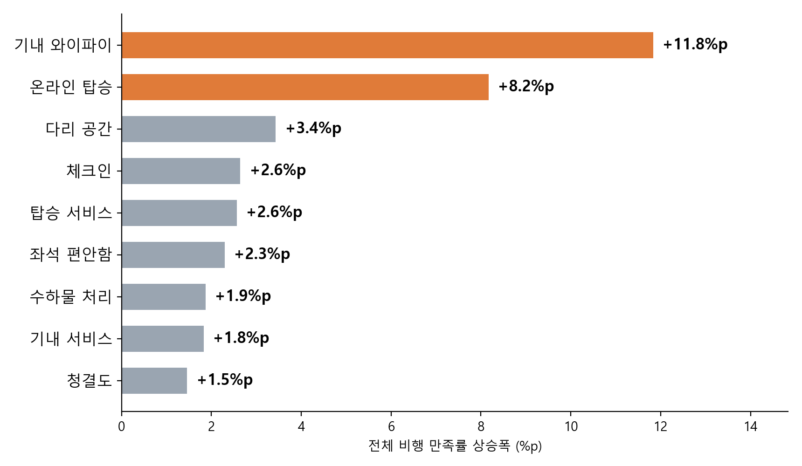
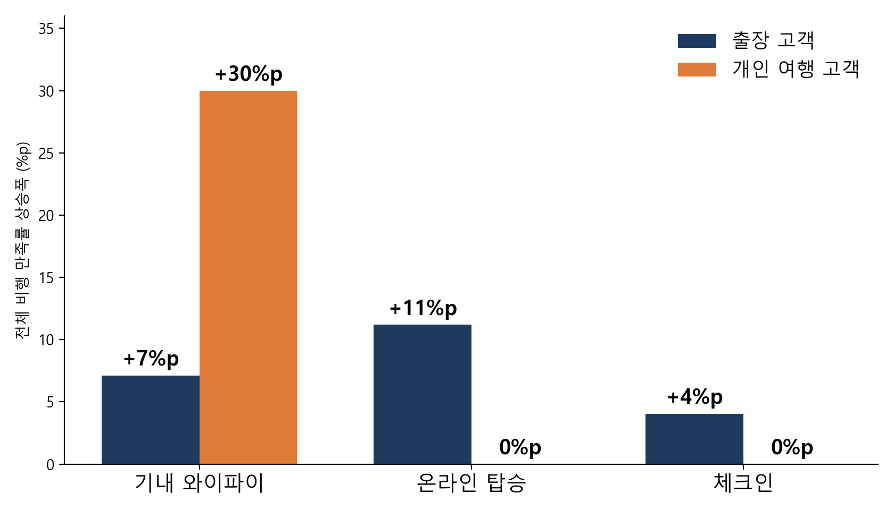
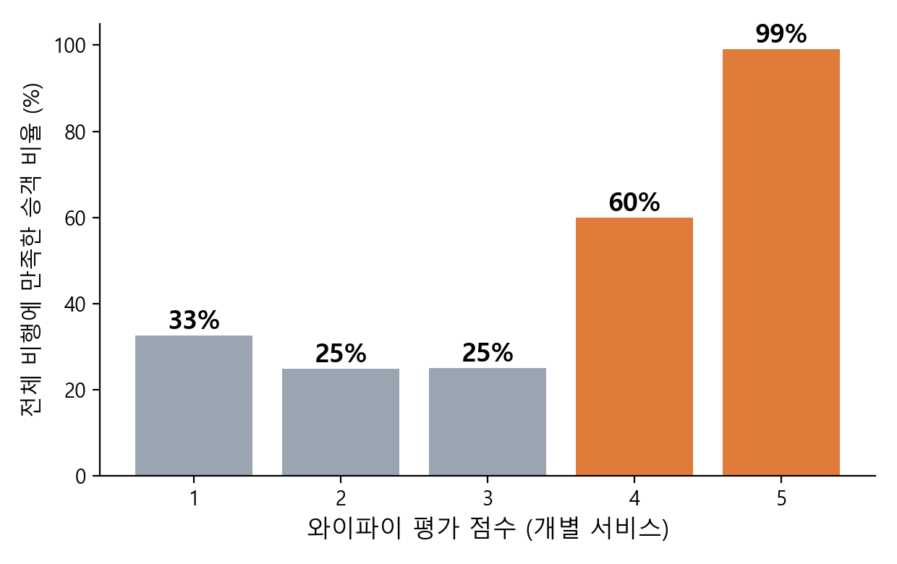

# 항공 승객 만족도 분석

**질문**: 한정된 예산에서 어떤 서비스부터 개선해야 전체 비행 만족률이 가장 많이 오르는가?

**데이터**: Kaggle 항공 승객 만족도 설문 ("Airline Passenger Satisfaction"), 승객 103,904명 × 24개 컬럼. 서비스 평가 14개 항목은 0~5점 (0은 해당없음)

**방법**: 서비스 평가를 "4점 이상 여부"로 바꿔 로지스틱 회귀로 추정하고, 서비스별로 4점 미만 → 4점 이상 개선 시 전체 비행 만족률 상승폭(%p)을 비교

## 핵심 결과

| 순위 | 서비스 | 개선 시 전체 비행 만족률 상승폭 |
|---|---|---|
| 1 | 기내 와이파이 | +11.8%p |
| 2 | 온라인 탑승 | +8.2%p |
| 3 | 다리 공간 | +3.4%p |
| 4 | 체크인 | +2.6%p |

- 현재 전체 비행 만족률은 43.3%. 음식·게이트 위치는 영향이 거의 없음
- **와이파이와 온라인 탑승을 전체 승객 대상으로 우선 개선**
- 승객 유형별 확인: 와이파이는 출장(+7%p)·개인 여행(+30%p) 모두 상승, 온라인 탑승·체크인은 출장 승객에서만 상승
- 모델 성능(검증 데이터): 정확도 89.3%, AUC 0.943 (4점 기준 적용 전 87.7%, 0.928)




## 분석 흐름

1. **전처리**: 도착 지연 결측 310건은 출발 지연 기반 회귀로 대체, 비행 거리 이상치는 IQR 기준 보정, 중복 정보 변수(VIF 14.9)인 도착 지연 제외
2. **기준 설정**: 서비스 점수가 3점 → 4점이 될 때 전체 비행 만족률이 급증 (와이파이 25% → 60%) → "4점 미만 vs 4점 이상"

   
3. **모델**: 로지스틱 회귀. 승객 유형을 고정한 상태에서 서비스별 효과를 비교하고, 예측 확률의 변화를 만족률 상승폭(%p)으로 계산
4. **추가 확인**: 출장 / 개인 여행 등 승객군별로 모델을 따로 만들어 같은 분석 반복

## 실행 방법

1. 데이터 준비: Kaggle에서 `train.csv`를 받아 `data/train.csv`에 저장 (다른 위치면 환경변수 `AIRLINE_TRAIN_CSV`로 경로 지정). 데이터는 저장소에 포함하지 않음
2. 설치: `pip install -r requirements.txt` (차트·PPT에 한글 폰트 필요: Windows 맑은 고딕, macOS AppleGothic, Linux 나눔고딕 등)
3. 저장소 루트에서 번호 순서대로 실행

```bash
python code/01_analysis.py          # 전처리, 로지스틱 회귀, 성능 (수치는 output/)
python code/02_service_lift.py      # 서비스별 개선 효과, 승객군별 효과
python code/03_charts.py            # 승객 유형별·와이파이 점수별 차트
python code/03b_segment_chart.py    # 출장 vs 개인 여행 효과 차트
python code/04_tableau_data.py      # 대시보드·Tableau용 집계 CSV
python code/05_build_dashboard.py   # HTML 대시보드 생성
python code/06_build_deck.py        # 발표용 PPT 생성
```

## 폴더 구조

```
code/        분석·차트·대시보드·PPT 생성 스크립트 (config.py: 경로와 폰트 설정)
charts/      차트 이미지
dashboard/   HTML 대시보드 템플릿
data/        train.csv 위치 (저장소 제외)
output/      실행 결과물 (저장소 제외)
```

실행 후 `output/`에 생성되는 파일

| 파일 | 내용 |
|---|---|
| `airline_dashboard.html` | 핵심 결과 · 개선 시뮬레이터 · 데이터 탐색 대시보드 (브라우저로 열기) |
| `airline_satisfaction_deck.pptx` | 발표 자료 13장 |
| `tableau/*.csv` | Tableau용 집계 데이터 (서비스별 효과, 승객군별 효과, 점수별 만족률) |
| `res.json`, `lift.json`, `or_table.csv` | 모델 성능과 효과 수치 |

## 한계

- 설문 상관 분석이므로 인과 효과는 시범 적용(A/B)으로 확인 필요
- 평가 점수 0(해당없음)을 낮은 점수와 동일하게 처리
- 개선 비용 데이터가 없어 ROI 우선순위는 산출하지 못함
- 여러 서비스를 동시에 개선한 예측값은 모델이 학습 범위를 벗어난 외삽이라 실제보다 크게 나올 수 있음
