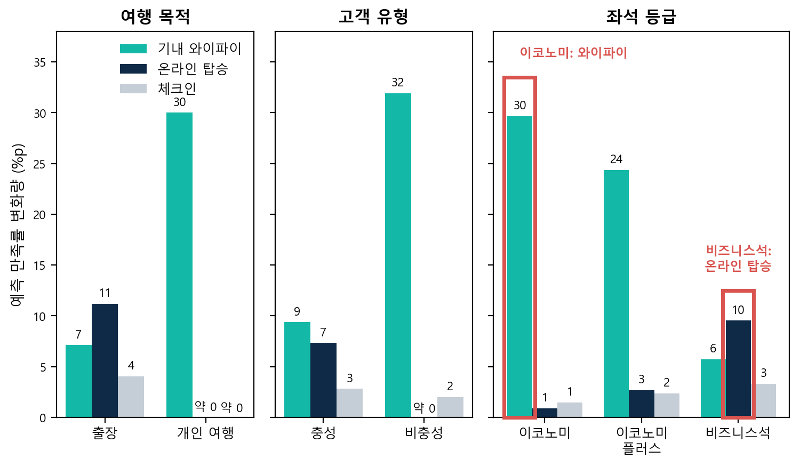

# 항공 승객 만족도 분석: 무엇부터 개선해야 만족도가 오를까

> 항공 승객 설문 10만 건에 로지스틱 회귀를 적용해, 한정된 예산에서 어떤 서비스를 먼저 개선해야 전체 만족률이 가장 많이 오르는지 순위를 정한 프로젝트입니다.

| | |
|---|---|
| 기간 | 2026.02 수행, 2026.10 고도화 (개인 프로젝트) |
| 데이터 | Kaggle Airline Passenger Satisfaction (승객 103,904명, 24개 항목) |
| 사용 기술 | Python (pandas, statsmodels, scikit-learn, matplotlib), 로지스틱 회귀, HTML/JavaScript 대시보드, Tableau |
| 바로 보기 | [대시보드](https://taejungjang.github.io/airline_satisfaction_analysis/airline_dashboard.html) · [코드 설명서](CODE_GUIDE.md) |

## 문제

승객 10명 중 6명은 전체 비행에 만족하지 못했습니다(만족률 43.3%). 개선할 수 있는 서비스는 14개인데 예산은 한정되어 있어서, 어떤 서비스부터 개선할지 근거가 필요했습니다.

## 핵심 결과

- 서비스 평가를 4점 이상으로 올리는 것을 '개선'으로 정했습니다. 서비스 14개 중 9개에서 3점 → 4점일 때 만족률이 +22–49%p 크게 올랐기 때문입니다.
- 모든 승객의 해당 서비스 평가를 4점 이상으로 설정했을 때 모델이 예측한 전체 만족률 변화량은 기내 와이파이 +11.8%p, 온라인 탑승 +8.2%p로 가장 컸고, 나머지는 +3.4%p 이하였습니다. 음식, 게이트 위치는 거의 영향이 없었습니다.
- 개선은 전체 승객에게 하되, 예산이 한정되면 좌석 등급별로 우선순위를 다르게 둘 수 있습니다. 이코노미 계열은 와이파이(+24–30%p), 비즈니스석은 온라인 탑승(+9.5%p) 효과가 컸습니다.
- 모델 성능: 검증 데이터 정확도 89.3%, AUC 0.943 (4점 기준을 적용하기 전에는 87.7%, 0.928)

제안: 기내 와이파이 → 온라인 탑승 순으로 우선 개선

## 분석 흐름

1. 전처리: 도착 지연 빈칸 310건을 출발 지연으로 예측해 채우고, 비행 거리 이상치를 IQR 기준으로 자르고, 정보가 겹치는 도착 지연 변수를 제거(VIF 14.9)
2. 개선 기준 정하기: 서비스 점수별 만족률 그래프로 4점 이상을 기준으로 선택
3. 로지스틱 회귀: 전체 비행 만족(1) / 중립·불만(0)을 예측. 서비스 평가(4점 이상 여부)와 성별, 연령, 고객 유형, 여행 목적, 좌석 등급, 비행 거리, 출발 지연을 함께 넣어 영향을 분리. 학습 80% / 검증 20%
4. 우선순위 계산: 오즈비로 영향의 크기를 확인하고, 이해하기 쉽게 모델이 예측한 만족률 변화량(%p)으로 바꿔 순위를 정함
5. 구분별 비교: 여행 목적, 고객 유형, 좌석 등급별로 모델을 따로 학습해 같은 계산을 반복
6. 대시보드: 서비스별 순위, 승객군별 비교, 개선 시뮬레이터, 데이터 탐색

## 분석 결과 상세

### 1. 몇 점부터 '개선'으로 볼까: 4점 이상
서비스 14개를 점수별 만족률로 그려 보니, 9개 서비스에서 3점 → 4점일 때 만족률이 크게 올랐습니다. 그래서 평가 4점 이상을 만족 수준으로 보고, 4점 미만 → 4점 이상을 '개선'으로 정했습니다. (체크인과 청결도는 2점 → 3점에서, 게이트 위치와 출·도착 시간은 뚜렷한 패턴이 없었습니다.)


### 2. 어떤 서비스를 먼저 개선할까: 예측 만족률 변화량(%p) 순위
오즈비는 다른 조건이 같을 때 해당 서비스가 4점 이상이면 만족 오즈가 몇 배가 되는지입니다. 우선순위는 만족률 변화량(%p, 퍼센트끼리의 차이)으로 정했으며, 이는 모든 승객의 해당 서비스 평가를 4점 이상으로 설정했을 때 모델이 예측한 전체 만족률 변화량입니다(실제 개선 결과가 아닌 예측값).

| 순위 | 서비스 | 오즈비 | 모델 예측 만족률 변화량 (현재 43.3%) |
|---|---|---|---|
| 1 | 기내 와이파이 | 5.7배 | +11.8%p |
| 2 | 온라인 탑승 | 4.9배 | +8.2%p |
| 3 | 다리 공간 | 2.2배 | +3.4%p |
| 4 | 체크인 | 2.5배 | +2.6%p |

음식, 온라인 예약, 엔터테인먼트는 오즈비가 1 근처로 영향이 없었습니다.


### 3. 승객 구분별로는
모델에서 영향이 큰 구분(여행 목적, 고객 유형, 좌석 등급)으로 나눠 같은 분석을 반복했습니다. 단위는 %p(모델 예측 변화량)입니다.



| 구분 | 그룹 | 현재 만족률 | 와이파이 | 온라인 탑승 | 체크인 |
|---|---|---|---|---|---|
| 여행 목적 | 출장 | 58.3% | +7.1 | +11.2 | +4.0 |
| | 개인 여행 | 10.2% | +30.0 | 변화 미미(약 0) | 변화 미미(약 0) |
| 고객 유형 | 충성 | 47.7% | +9.4 | +7.3 | +2.8 |
| | 비충성 | 23.7% | +31.9 | 변화 미미(약 0) | +2.0 |
| 좌석 등급 | 이코노미 | 18.6% | +29.6 | +0.9 | +1.5 |
| | 이코노미 플러스 | 24.6% | +24.4 | +2.7 | +2.4 |
| | 비즈니스석 | 69.4% | +5.7 | +9.5 | +3.3 |

서비스 개선은 전체 승객에게 하되, 예산이 한정되면 객실(좌석 등급) 단위로 우선순위를 다르게 둘 수 있습니다. 이코노미 계열은 와이파이, 비즈니스석은 온라인 탑승입니다(비즈니스석 승객의 96%가 출장 승객). 여행 목적과 고객 유형은 승객을 골라 개선할 수 없어 참고용입니다.

## 한계와 다음 단계

- 설문 상관 분석이므로 인과 효과는 시범 적용(A/B 테스트)으로 확인해야 합니다.
- 평가 점수 0(해당 없음)을 낮은 점수와 동일하게 처리했습니다.
- 개선 비용 데이터가 없어 ROI 우선순위는 산출하지 못했습니다. 비용 데이터가 생기면 ROI 분석을 추가합니다.
- 여러 서비스를 동시에 개선한 예측값은 모델이 학습 범위를 벗어난 외삽이라 실제보다 크게 나올 수 있습니다.

## 폴더 구조

```
code/
  config.py              파일 경로와 그래프 한글 글꼴 설정
  common.py              공통 기능: 데이터 읽기, 전처리, 모델 학습, 만족률 변화량 계산 (01, 02, 04가 함께 사용)
  01_analysis.py ... 05_build_dashboard.py   아래 실행 방법의 순서대로 실행하는 코드
charts/                  README에 쓰는 그래프 이미지
dashboard/               HTML 대시보드 템플릿
airline_dashboard.html   완성된 대시보드 (위 링크로 바로 실행)
CODE_GUIDE.md            실행 흐름, 파일별 역할, 이 문서의 숫자가 나오는 곳
data/                    train.csv 위치 (저장소 제외)
output/                  실행 결과물 (저장소 제외)
```

## 실행 방법

1. 데이터 준비: Kaggle에서 `train.csv`를 받아 `data/train.csv`에 저장합니다(다른 위치면 환경변수 `AIRLINE_TRAIN_CSV`로 경로 지정). 데이터는 저장소에 포함하지 않았습니다.
2. 설치: `pip install -r requirements.txt` (그래프에 한글 글꼴 필요: Windows 맑은 고딕, macOS AppleGothic, Linux 나눔고딕 등)
3. 저장소 루트에서 번호 순서대로 실행합니다.

```bash
python code/01_analysis.py          # 전처리, 로지스틱 회귀, 모델 성능과 오즈비 (output/res.json, or_table.csv)
python code/02_service_lift.py      # 서비스별, 구분별 예측 만족률 변화량 (output/lift.json)
python code/03_charts.py            # README 그래프 3개 (charts/)
python code/04_tableau_data.py      # 대시보드, Tableau용 CSV (output/tableau/)
python code/05_build_dashboard.py   # HTML 대시보드 (airline_dashboard.html)
```
