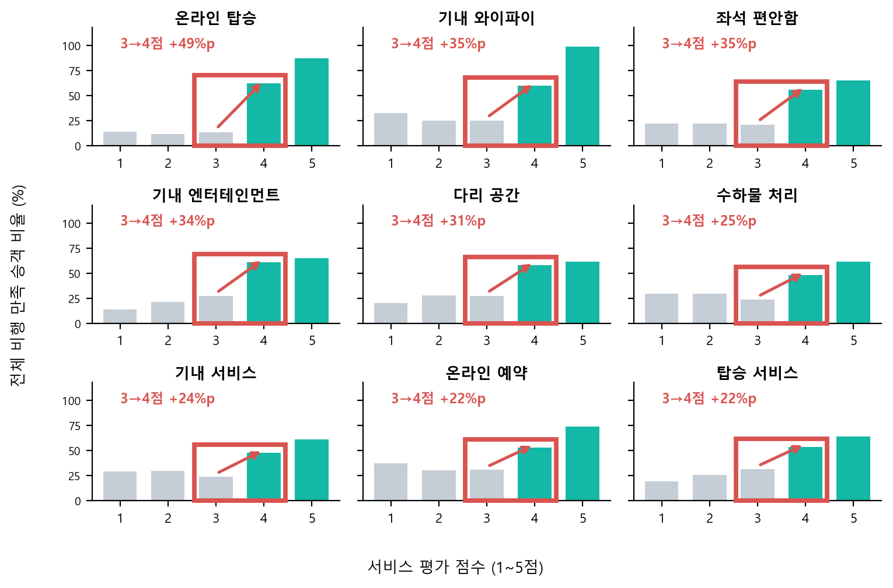
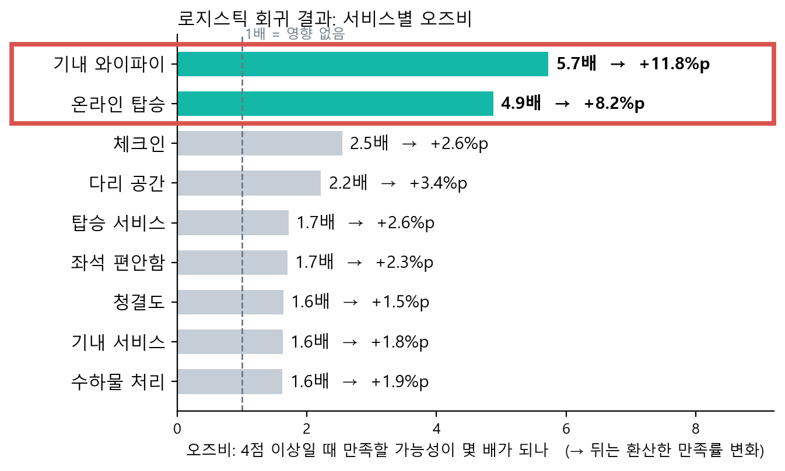
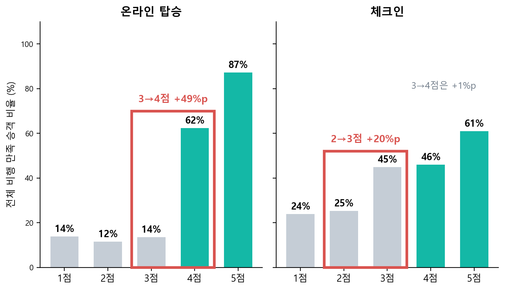

# 항공 승객 만족도 분석

수행 2026.02 / 고도화 2026.10 (개인 프로젝트)

**대시보드 바로 열기**: https://taejungjang.github.io/airline_satisfaction_analysis/airline_dashboard.html

## 한 줄 요약
승객 10명 중 6명은 전체 비행에 만족하지 못했습니다(만족률 43.3%). 서비스는 14개인데 예산은 한정되어 있어, 어떤 서비스를 먼저 개선해야 만족률이 가장 많이 오를지 로지스틱 회귀로 비교했습니다. 결과는 **기내 와이파이 → 온라인 탑승** 순입니다.

- 데이터: Kaggle "Airline Passenger Satisfaction", 승객 103,904명 x 24개 항목 (서비스 평가 14개는 0~5점, 0은 해당 없음)
- 모델: 로지스틱 회귀 (전체 비행 만족=1 / 중립·불만=0). 서비스 평가를 "4점 이상 여부"로 바꿔 넣고, 성별·연령·고객 유형·여행 목적·좌석 등급·비행 거리·출발 지연도 함께 넣어 영향을 분리
- 검증: 학습 80% / 검증 20%, 정확도 89.3%, AUC 0.943 (4점 기준 적용 전 87.7%, 0.928)

## 분석 흐름과 결과

### 1. 몇 점부터 '개선'으로 볼까: 4점 이상
서비스 14개를 점수별 만족률로 그려 보니, 9개 서비스에서 3점 → 4점일 때 만족률이 크게 올랐습니다(+22~49%p). 그래서 평가 4점 이상을 만족 수준으로 보고, 4점 미만 → 4점 이상을 '개선'으로 정했습니다. (체크인·청결도는 2→3점에서, 게이트 위치·출도착 시간은 뚜렷한 패턴이 없었습니다.)



### 2. 어떤 서비스를 먼저 개선할까: 오즈비로 순위
오즈비는 다른 조건이 같을 때 해당 서비스가 4점 이상이면 만족할 가능성이 몇 배가 되는지입니다. 오즈비 순위로 우선순위를 정하고, 이해하기 쉽게 예측 만족률 변화(%p, 퍼센트끼리의 차이)로 환산했습니다.

| 순위 | 서비스 | 오즈비 | 예측 만족률 변화 (현재 43.3%) |
|---|---|---|---|
| 1 | 기내 와이파이 | 5.7배 | +11.8%p |
| 2 | 온라인 탑승 | 4.9배 | +8.2%p |
| 3 | 다리 공간 | 2.2배 | +3.4%p |
| 4 | 체크인 | 2.5배 | +2.6%p |

음식·온라인 예약·엔터테인먼트는 오즈비가 1 근처로 영향이 없었습니다.



### 3. 온라인 탑승과 체크인은 무엇이 다른가
설문에서 따로 평가된 별개 항목입니다(데이터 설명에는 만족도로만 표기되어 일반적인 의미로 풀이: 온라인 탑승은 앱·웹으로 하는 탑승 절차, 체크인은 공항에서 받는 수속 서비스). 온라인 탑승은 3점 14% → 4점 62%(+49%p)로 크게 뛰고, 체크인은 3점에서 이미 45%라 4점이 돼도 46%(+1%p)로 4점 기준의 효과가 작았습니다.



### 4. 승객 구분별로는
모델에서 영향이 큰 구분(여행 목적, 고객 유형, 좌석 등급)으로 나눠 같은 분석을 반복했습니다. 단위는 %p입니다.

| 구분 | 그룹 | 현재 만족률 | 와이파이 | 온라인 탑승 | 체크인 |
|---|---|---|---|---|---|
| 여행 목적 | 출장 | 58.3% | +7.1 | +11.2 | +4.0 |
| | 개인 여행 | 10.2% | +30.0 | 변화 미미(약 0) | 변화 미미(약 0) |
| 고객 유형 | 충성 | 47.7% | +9.4 | +7.3 | +2.8 |
| | 비충성 | 23.7% | +31.9 | 변화 미미(약 0) | +2.0 |
| 좌석 등급 | 이코노미 | 18.6% | +29.6 | +0.9 | +1.5 |
| | 이코노미 플러스 | 24.6% | +24.4 | +2.7 | +2.4 |
| | 비즈니스석 | 69.4% | +5.7 | +9.5 | +3.3 |

서비스 개선은 전체 승객에게 하되, 예산이 한정되면 객실(좌석 등급) 단위로 우선순위를 다르게 둘 수 있습니다: 이코노미 계열은 와이파이, 비즈니스석은 온라인 탑승 (비즈니스석 승객의 96%가 출장 승객).

## 제안
**기내 와이파이 → 온라인 탑승 순으로 우선 개선**

## 한계
- 설문 상관 분석이므로 인과 효과는 시범 적용(A/B)으로 확인 필요
- 평가 점수 0(해당 없음)을 낮은 점수와 동일하게 처리
- 개선 비용 데이터가 없어 ROI 우선순위는 산출하지 못함
- 여러 서비스를 동시에 개선한 예측값은 모델이 학습 범위를 벗어난 외삽이라 실제보다 크게 나올 수 있음

## 실행 방법
1. 데이터 준비: Kaggle에서 `train.csv`를 받아 `data/train.csv`에 저장 (다른 위치면 환경변수 `AIRLINE_TRAIN_CSV`로 경로 지정). 데이터는 저장소에 포함하지 않음
2. 설치: `pip install -r requirements.txt` (차트에 한글 폰트 필요: Windows 맑은 고딕, macOS AppleGothic, Linux 나눔고딕 등)
3. 저장소 루트에서 번호 순서대로 실행

```bash
python code/01_analysis.py          # 전처리, 로지스틱 회귀, 성능 (수치는 output/)
python code/02_service_lift.py      # 서비스별 개선 효과, 구분별 효과
python code/03_charts.py            # 승객 유형별·와이파이 점수별 차트
python code/03b_segment_chart.py    # 출장 vs 개인 여행 효과 차트
python code/04_tableau_data.py      # 대시보드·Tableau용 집계 CSV
python code/05_build_dashboard.py   # HTML 대시보드 생성 (airline_dashboard.html)
```

## 폴더 구조
```
code/                    분석·차트·대시보드 생성 스크립트 (config.py: 경로와 폰트 설정)
charts/                  차트 이미지
dashboard/               HTML 대시보드 템플릿
airline_dashboard.html   완성된 대시보드 (위 링크로 바로 실행)
data/                    train.csv 위치 (저장소 제외)
output/                  실행 결과물 (저장소 제외)
```
